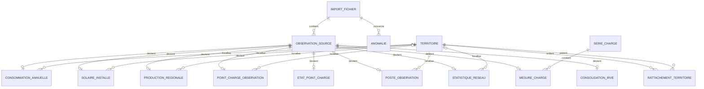

# Schéma de la base PostgreSQL/PostGIS

## 1. Une seule base, quatre espaces de rangement

La base s’appelle **`enedis`**. Les « schémas » ci-dessous sont des espaces de rangement à l’intérieur de la même base, pas quatre bases distinctes.

| Schéma | Rôle |
| --- | --- |
| `meta` | Savoir quels fichiers ont été importés et conserver le suivi de qualité |
| `staging` | Conserver les valeurs sources avant leur conversion |
| `core` | Stocker les observations avec des types utilisables en SQL |
| `analytics` | Proposer des vues de lecture aux autres modules |

```text
CSV ou Parquet
      ↓ script Python d’import
meta.import_fichier : provenance de la livraison
      ↓
staging.observation : chaque ligne source, sans perte de colonnes
      ↓ conversion des types ; cellules vides → NULL
core : consommation, solaire, production, bornes, réseau, courbes
      ↓
analytics : vues de consultation, sans modifier les observations
```

À ce stade, **l’import Python est fourni uniquement pour la consommation**. Les autres tables sont prévues dans le SQL, mais restent vides. Aucun fichier SQL ni import n’a été exécuté lors de leur préparation.

## 2. Les tables prévues

`id` désigne une clé interne qui identifie une ligne. Une référence vers une autre table permet de retrouver l’information liée.

| Table | Ce que représente une ligne | Principales informations |
| --- | --- | --- |
| `meta.import_fichier` | Un fichier importé avec une version de traitement | Nom, empreinte SHA-256, date, jeu, nombre de lignes |
| `staging.observation` | Un enregistrement du fichier source | Import, numéro d’enregistrement et toutes les valeurs dans un objet JSON |
| `meta.anomalie` | Un problème à tracer | Import, enregistrement, colonne et explication ; table prévue, non remplie automatiquement par le premier import |
| `core.territoire` | Une version datée d’une commune, EPCI, département, région ou périmètre Enedis | Code texte, nom, niveau, dates et contour éventuel |
| `core.rattachement_territoire` | Un lien géographique daté | Territoire enfant, parent et dates |
| `core.consommation_annuelle` | Une observation communale annuelle avec ses catégories | Toutes les colonnes du CSV dans des colonnes typées, lien source et territoire facultatif |
| `core.solaire_installe` | Une puissance à une date et à une échelle | Code source, territoire facultatif, type d’installation, vecteur et MW |
| `core.production_regionale` | Une observation de production | Région, instant, filière, tranche, nombre de points et énergie Wh |
| `core.point_charge_observation` | Une description de point de charge dans une livraison | Identifiants du point et de la station, commune, puissance et position |
| `core.etat_point_charge` | Un état horodaté de point de charge | Identifiant source, état et occupation |
| `core.poste_observation` | Un poste décrit dans une livraison | Commune, date d’observation si connue et position |
| `core.statistique_reseau` | Des statistiques territoriales annuelles | Maille, code source, année, longueurs et nombre de postes |
| `core.serie_charge` | Une série d’un groupe RES2 | Groupe, identifiant et unité à confirmer |
| `core.mesure_charge` | Une valeur horodatée d’une série | Série, instant et valeur |
| `meta.consolidation_irve` | Un résultat de consolidation d’une ressource | Identifiants, statuts et erreurs |

Chaque table d’observations liée à `staging.observation` permet de retrouver toutes les colonnes originales. Pour les autres jeux, les colonnes typées proposées sont un premier noyau à compléter lors de leurs imports. Les bornes n’ont pas encore de table distincte de stations : l’identifiant de station est conservé dans leur description.

## 3. Relations entre les tables



Un territoire peut rester non renseigné si sa correspondance n’est pas encore établie. Le code géographique source reste conservé. Les courbes RES2 n’ont pas de lien vers une commune, car leurs fichiers ne fournissent pas cette information.

Les états IRVE seront rapprochés des descriptions par identifiant et période compatibles. On ne crée pas une relation directe vers une description unique : les descriptions peuvent évoluer et certains états peuvent être sans correspondance.

## 4. Zoom sur la consommation

```text
meta.import_fichier
  id_import
  nom_fichier, empreinte, date, version, nombre_lignes
       │
       └── staging.observation
             id_observation
             id_import, numero_enregistrement, donnees_source
                  │
                  └── core.consommation_annuelle
                        id_consommation
                        id_observation
                        id_territoire (facultatif)
                        annee, code_commune, nom_commune
                        codes et noms EPCI / département / région
                        code_categorie_consommation
                        code_grand_secteur, code_secteur_naf2
                        nb_sites
                        conso_totale_mwh, conso_moyenne_mwh
                        nombre_de_mailles_secretisees
                        autres mesures climatiques et de logement
                        codes et noms PNR / EPT
```

Le dictionnaire exact des colonnes et de leurs types se trouve dans [colonnes_consommation.json](../../sql/module_1/colonnes_consommation.json). Le fichier SQL crée une colonne pour chaque champ du CSV. Les noms SQL sont écrits sans espaces ni accents.

- Codes et libellés : `text`, pour conserver notamment les zéros initiaux.
- Année : `integer`.
- Nombre de sites : `bigint`, un entier.
- Mesures : `numeric`, pour conserver des nombres décimaux.
- Valeur absente : `NULL`, jamais un zéro ajouté automatiquement.

La clé candidate commune + année + catégorie + secteur + NAF2 n’est pas imposée comme contrainte unique entre toutes les livraisons : un même territoire peut réapparaître dans un fichier mis à jour. La provenance permet de distinguer ces versions.

## 5. Vues de lecture

| Vue | Contenu |
| --- | --- |
| `analytics.consommation_detail` | Colonnes de consommation, import, numéro source et indicateur de consommation manquante |
| `analytics.suivi_imports` | Fichiers importés et nombre d’observations sources enregistrées |

Ces vues ne font aucune somme, moyenne ou prédiction. Filtrer par `id_import` pour choisir une livraison.

## 6. Limites à garder en tête

- Le SQL ne charge pas les référentiels : il crée seulement leurs tables. L’unicité des versions et l’absence de chevauchements de dates devront être contrôlées au chargement.
- Les contours et positions utilisent le SRID 4326. Il faudra transformer les coordonnées sources si leur système diffère ; ne pas simplement leur attribuer ce SRID.
- Pour la production, les instants seront stockés en `timestamptz`, et les dates métier calculées explicitement en `Europe/Paris`.
- Les 70 Parquet alimenteront une table logique de production ; un partitionnement physique pourra être ajouté avant ce gros import selon les performances.
- Le lien entre source et table typée est protégé par une clé étrangère. Les règles propres aux autres jeux restent à compléter après leur diagnostic.

Pour les étapes de création et les commandes, suivre [installation-base.md](installation-base.md).

Pour retrouver les noms exacts des fichiers sources de chaque table : [correspondance entre fichiers et tables](correspondance-fichiers-tables.md).

## Évolution du besoin : interface Python générique

Le schéma métier décrit ci-dessus reste une proposition. Pour centraliser les fichiers actuels sans SQL manuel, utiliser désormais [le package `enedis.database`](package-database.md) : tables dans `donnees`, suivi dans `database_meta`, et évolution additive des colonnes depuis Python. Les deux parcours ne sont pas synchronisés automatiquement ; choisir celui à utiliser avant le chargement.
